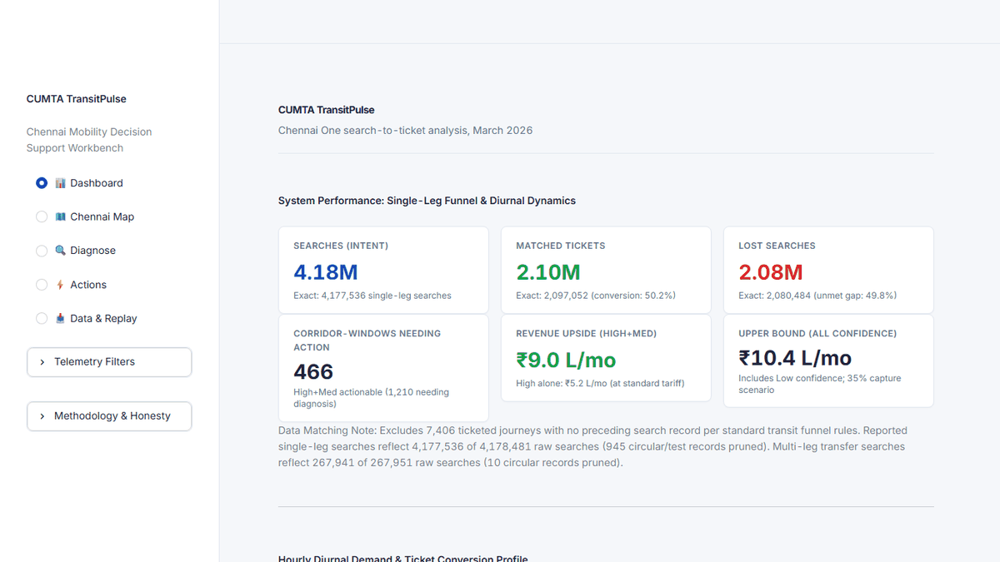
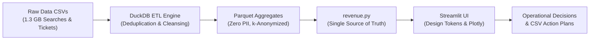

# CUMTA TransitPulse

[](https://www.python.org/)
[](https://streamlit.io/)
[](https://duckdb.org/)
[](LICENSE)

> **Evidence-Based Transit Planning**: Transforming commuter search intent from the Chennai One app into defensible operational decisions and schedule interventions across Chennai.

🔗 **[Live Demo on Streamlit Community Cloud](https://harishponnar-cumta-transitpulse-app-ub1dmp.streamlit.app)**

---

## Interactive Walkthrough



*5-Tab Decision-Support Workbench: Executive Dashboard, Chennai Transit Network Map, Root-Cause Diagnosis Dossier, Action Plan & Revenue Simulator, Data Cleansing Audit & March 2026 Replay.*

---

## The Problem

Millions of commuters search for bus, rail, and metro connections every month on the Chennai One mobile app, but nearly half of those searches do not convert into issued tickets, leaving transport authorities blind to latent travel demand. Traditional physical surveys and manual counts fail to pinpoint where, when, and why commuters abandon public transit for private modes. TransitPulse bridges this gap by transforming raw digital search sessions and ticket logs into actionable, corridor-level operational decisions across the Chennai Metropolitan Area.

---

## What It Does

- **📊 Executive Dashboard**: Tracks the single-leg conversion funnel (4.18M searches, 2.10M matched tickets, 2.08M unmet searches) alongside 24-hour diurnal demand profiles and day-of-week intensity heatmaps.
- **🗺️ Chennai Transit Network Map**: Visualizes 54 major metropolitan transit hubs with bottleneck scoring, desire-line flows, and transfer penalty friction ratios.
- **🔍 Corridor Root-Cause Diagnosis**: Classifies bottlenecks across 1,210 corridor windows into operational causes (*Off-Peak Frequency Deficit*, *Crowding / Capacity Overrun*, *Fare Sensitivity*, *Transfer Friction*).
- **⚡ Actions & Revenue Simulator**: Prioritizes 466 actionable bus corridors and models recoverable monthly revenue under variable capture rates (10%–70%) using standard graduated MTC route tariffs.
- **📥 Data Inspector & March 2026 Replay**: Provides a complete audit trail of data pruning decisions and reproduces hourly commuter flows in a chronological replay format.

---

## Key Findings

All figures derive strictly from the March 2026 Chennai One operational dataset:

1. **Massive Latent Demand**: Out of **4,177,536** valid single-leg search sessions, only **2,097,052** converted into matched tickets (**50.2%** conversion rate), leaving **2,080,484** searches (**49.8%**) unserved.
2. **Transfer Friction Collapse**: While direct single-leg journeys convert at ~50.2%, multi-leg transfer searches suffer severe drop-off: out of **267,941** transfer searches, only **922** converted into ticketed journeys (**0.34%** conversion rate).
3. **Fare Sensitivity on Premium Corridors**: On parallel corridors such as Route 543001 (premium air-conditioned express) vs Route 543 (standard regular service), the premium route converted at only **2.6%** compared to **49.6%** on standard service, with over 50% of commuters co-searching standard options within the same minute.
4. **Pronounced Diurnal Surges**: Conversion drops severely during the morning peak (08:00–10:00) and evening return peak (17:00–19:00), indicating systemic vehicle crowding and capacity overrun rather than lack of passenger intent.
5. **Actionable Revenue Opportunity**: Addressing the **466** High and Medium confidence actionable corridors at a conservative 35% capture scenario projects **₹9.02 Lakhs/month** (₹902,237.23) in recoverable revenue at standard MTC stage fares.

---

## How It Works

### Architecture & Pipeline Flow



### Metric Definitions

| Metric | Definition | Formulation / Operational Rule |
|---|---|---|
| **Chennai One Searches** | Single-leg search sessions indicating travel intent | $\sum \text{Searches} - \text{Circular/Test Records (945)}$ |
| **Matched Tickets (Proxy)** | Issued digital tickets successfully linked to a search | Matched by `journey_id` ($2,097,052$ journeys) |
| **Lost Searches (Unmet)** | Search sessions where no digital ticket was purchased | $\text{Valid Searches} - \text{Matched Tickets}$ ($2,080,484$) |
| **Conversion Rate** | Percentage of search intent converted into tickets | $\frac{\text{Matched Tickets}}{\text{Valid Searches}} = 50.20\%$ |
| **Transfer Penalty Ratio** | Disutility penalty of multi-leg transfers vs. direct legs | $\frac{\text{Multi-Leg Duration}}{\text{Leg 1 Duration} + \text{Leg 2 Duration}}$ |
| **Revenue Upside (High+Med)** | Monthly revenue recovery for 466 actionable corridors at 35% capture | **₹9.02 Lakhs/month** (₹902,237.23) |
| **Upper Bound (All Conf)** | Potential monthly recovery across all 1,210 corridors at 35% capture | **₹10.44 Lakhs/month** (₹1,044,195.02) |

---

## Engineering Highlights

- **1.3 GB Telemetry Processing with DuckDB**: Replaced slow full-table scans with an in-memory DuckDB columnar pipeline, executing multi-million row regex filtering, deduplication, and window functions in under 90 seconds.
- **Deterministic Journey Matching**: Directly matched commuter search intent to issued tickets by `journey_id`, isolating 7,406 orphan ticketed journeys (purchases without search sessions) to ensure conversion metrics remain mathematically pure.
- **Relative Root-Cause Classification**: Dynamically classified bottlenecks across 1,210 corridor windows by comparing volume percentiles against diurnal conversion drops rather than arbitrary hardcoded cutoffs.
- **Single-Source-of-Truth Economic Engine**: Built an audited revenue engine (`revenue.py`) that enforces standard MTC stage fares (₹15 bus base, ₹20 rail base) and verifies invariant monotonicity ($\text{Rev}_{\text{High}} \le \text{Rev}_{\text{High+Med}} \le \text{Rev}_{\text{All}}$) across all UI cards, simulator dials, and CSV exports.
- **Privacy by Design**: Permanent elimination of personal commuter identifiers (`commuter_id`), omission of raw journey UUIDs, and suppression of small cells ($< 10$ unique searchers).
- **Automated Test Harness**: Unit and integrity tests executed via Pytest validating 24/24 hour coverage, non-negative lost demand, tariff rules, and percentage bounds.

---

## Limitations and Assumptions

- **Tickets as a Proxy**: Issued tickets represent digital payment transactions, not physical passenger boardings. Searches reflect intent to travel, not guaranteed physical presence.
- **No Fleet GPS / AVL**: Real-time vehicle tracking and physical crowding (APC) are not present in the app dataset; crowding is inferred from high search volume with low conversion and repeated search attempts.
- **Invisible Cash Riders**: Telemetry reflects digital commuters using Chennai One; cash-paying passengers boarding via conductors are uncaptured.
- **Single Month Horizon**: Data represents March 2026. Seasonal variations (monsoon, festivals) require multi-month baselines.
- **Approximate Hub Coordinates**: Station positions derive from a curated manual reference list of 54 major hubs (`coord_source=manual_approx`).
- **Illustrative 35% Capture Scenario**: Revenue upside models an assumed 35% capture of lost demand upon operational improvements.
- **Replay Semantics**: Telemetry playback is explicitly designated as a **"Replay of March 2026 data"**, never simulated "live" telemetry.

---

## Run Locally

### 1. Sample Mode (Instant Demo — 3 Commands)

The repository includes a lightweight, pre-aggregated demo dataset in `sample_data/` (< 1 MB). Anyone can run the complete app immediately without access to raw data:

```bash
# 1. Clone the repository
git clone https://github.com/harishponnar/cumta-transitpulse.git
cd cumta-transitpulse

# 2. Install dependencies (Python 3.12 recommended)
pip install -r requirements.txt

# 3. Launch the workbench
streamlit run app.py
```
*The app will automatically detect sample mode and start at `http://localhost:8501`.*

### 2. Full-Data Mode (Production Pipeline)

To run the full preprocessing pipeline on raw data:
1. Store raw CSV files in a private directory (defaults to sibling directory `../transit-pulse-private/raw/` or set `RAW_DIR`):
   - `single_leg_searches_202603.csv`
   - `single_leg_journeys_202603.csv`
   - `multi_leg_searches_202603.csv`
   - `multi_leg_journeys_202603.csv`

2. Validate raw file availability with a pipeline dry run:
   ```bash
   python preprocess.py --step 0
   ```

3. Execute the full DuckDB pipeline:
   ```bash
   python preprocess.py
   ```

4. Launch the workbench:
   ```bash
   streamlit run app.py
   ```

### 3. Verification & Test Commands

```bash
# Run unit test suite
pytest

# Audit repository safety & zero-PII compliance
python scripts/check_repo_safety.py

# Verify revenue numbers, corridor counts & telemetry fidelity
python scripts/verify.py

# Run clean-clone isolated tab rendering test
python scripts/test_clone.py
```

---

## Data and Disclaimer

- **Data Ownership**: The raw transit telemetry used in this project was provided exclusively for competition problem solving and is kept outside this repository.
- **Prototype Status**: TransitPulse is an independent hackathon prototype developed for Problem Statement 6 (*From Chennai One Data to Mobility Decisions*). It is not an official product, service, or operational deployment of CUMTA, MTC, CMRL, or Chennai One, and does not imply endorsement by any metropolitan transport agency.
- **License Scope**: The [MIT License](LICENSE) applies strictly to the source code, analytics scripts, UI components, and documentation in this repository. It does not grant rights or licenses to any third-party transit datasets, proprietary route matrices, or agency trademarks.

---

## Repository Structure

```
cumta-transitpulse/
├── .github/
│   └── workflows/
│       └── ci.yml                  # GitHub Actions CI workflow (Python 3.12, ruff, pytest)
├── .streamlit/
│   └── config.toml                 # Neutral light theme & minimal toolbar
├── .gitattributes                  # LF/CRLF normalization & binary flags
├── .gitignore                      # Strict exclusion rules for raw data, logs & PII
├── pyproject.toml                  # Ruff linter & formatter configuration
├── LICENSE                         # MIT License (Code only)
├── README.md                       # Documentation with diagrams, metrics & demo
├── requirements.txt                # Pinned production dependencies
├── runtime.txt                     # Python 3.12 environment specification
├── app.py                          # Streamlit decision-support workbench
├── config.py                       # Operational constants & configurable paths
├── preprocess.py                   # High-speed DuckDB ETL pipeline
├── revenue.py                      # Single source of truth economic calculation engine
├── data_reference/
│   └── stop_coords.csv             # Manual approximate coordinates for 54 hubs
├── docs/
│   ├── architecture.md             # System design & DuckDB schema specifications
│   ├── methodology.md              # Analytical formulations & tariff models
│   ├── project_story.md            # First-person engineering narrative & learnings
│   ├── portfolio_notes.md          # Resume bullet points & LinkedIn description
│   ├── demo.gif                    # 5-tab animated interface walkthrough (< 1 MB)
│   └── screenshots/                # Clean interface screenshots (5 key views)
│       ├── tab1_dashboard.png
│       ├── tab2_chennai_map.png
│       ├── tab3_diagnose.png
│       ├── tab4_actions.png
│       └── tab5_data_replay.png
├── sample_data/                    # Lightweight demo dataset (< 1 MB, 0 PII)
│   ├── kpis.parquet
│   ├── city_hourly.parquet
│   ├── city_hour_dow.parquet
│   ├── diagnosis.parquet
│   ├── actions.parquet
│   ├── premium_rollup.parquet
│   ├── transfer_pairs.parquet
│   ├── transfer_pairs_aggregated.parquet
│   ├── hubs.parquet
│   └── route_hourly.parquet
├── scripts/
│   ├── check_repo_safety.py        # Real git security, PII & credential scanner
│   ├── verify.py                   # Math, telemetry & revenue consistency verifier
│   └── test_clone.py               # Isolated clean-clone test runner
├── tests/
│   ├── __init__.py
│   └── test_transitpulse.py        # Automated Pytest test suite (8 passed)
└── theme/
    ├── clean.css                   # Clean neutral design system tokens & responsive CSS
    ├── plotly_theme.py             # Accessible Plotly visualization template
    └── tokens.py                   # Color & typography constants
```

---

## Technology Stack

| Component | Technology | Purpose |
|---|---|---|
| **Analytical UI** | Streamlit `1.66.1` | Reactive decision-support dashboard & scenario simulator |
| **Query Engine** | DuckDB `2.0.0` | Ultra-fast in-memory ETL & multi-million row window functions |
| **Visualization** | Plotly `7.1.0` | Dual-axis diurnal curves, heatmaps & geographic network plots |
| **Columnar Storage**| PyArrow `26.0.1` & Pandas `3.1.1` | Compact Parquet serialization & schema validation |
| **Testing** | Pytest `9.2.0` | Invariant assertions, boundary conditions & privacy checks |
| **Code Quality** | Ruff `0.17.4` | Ultra-fast linter and code formatter |

---

## Author & Acknowledgements

- **Author**: Harish Ponnar ([GitHub Profile](https://github.com/harishponnar) • [LinkedIn](<LINKEDIN URL>))
- **Hackathon Organisers**: Chennai Unified Metropolitan Transport Authority (CUMTA) & Easwari Engineering College
- **Problem Statement 6**: *From Chennai One Data to Mobility Decisions* (March 2026)

---

## License

This project is licensed under the [MIT License](LICENSE).
