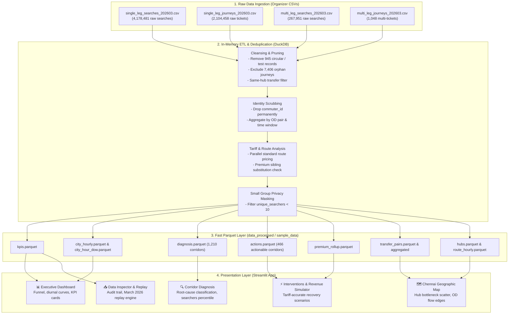

# TransitPulse Architecture & System Design

**Chennai Unified Metropolitan Transport Authority (CUMTA) — Mobility Decision Support Workbench**  
*Problem Statement 6: From Chennai One Data to Mobility Decisions*

---

## 1. High-Level Architecture Overview

TransitPulse transforms large-scale, high-velocity digital ticketing telemetry from the **Chennai One** transit app into actionable metropolitan mobility decisions. The architecture is engineered around strict privacy safeguards, high-throughput analytical query processing via DuckDB, compact Parquet aggregations, and an interactive Streamlit workbench.

---

## 2. Ingestion & Transformation Pipeline (`preprocess.py`)

The extraction, loading, and transformation pipeline is built with **DuckDB** to process millions of records in seconds while maintaining a low memory footprint:

1. **Deterministic Funnel Matching**:
   - Matches raw user search intent (`single_leg_searches`) against issued tickets (`single_leg_journeys`) via `journey_id`.
   - Identifies **2,097,052** successfully matched ticketed journeys out of **4,177,536** valid searches (conversion rate: **50.2%**).
   - Correctly segregates **7,406** orphan journeys (journeys initiated without a logged app search session) to avoid inflating funnel metrics.
   - Filters out 945 test station/circular records from single-leg searches and 10 circular records from multi-leg searches.

2. **Time Window Bucket Mapping**:
   Corridor demands are aggregated into four continuous operational time windows covering all 24 hours ($0 \le \text{hour} \le 23$):
   - **Morning Peak**: 07:00 – 10:59 (Hours 7, 8, 9, 10)
   - **Midday**: 11:00 – 15:59 (Hours 11, 12, 13, 14, 15)
   - **Evening Peak**: 16:00 – 20:59 (Hours 16, 17, 18, 19, 20)
   - **Night**: 21:00 – 06:59 (Hours 21, 22, 23, 0, 1, 2, 3, 4, 5, 6)

3. **Multi-Leg Transfer Pair Extraction**:
   - Prunes transfer searches where `from_hub == to_hub` (eliminating zero-distance round-trips).
   - Computes transfer penalty metrics:
     $$\text{Penalty Ratio} = \frac{\text{Multi-Leg Duration}}{\text{Leg 1 Duration} + \text{Leg 2 Duration}}$$
   - Aggregates OD transfer pairs across distinct intermediate hubs to eliminate fragmented duplicate corridors.

4. **Premium Sibling Substitution Analysis**:
   - Cross-analyzes premium bus routes (`543001`, `546001`, `918001`, `598001`) against parallel standard MTC routes (`543`, `546`, `918`, `598`).
   - Identifies cases where riders simultaneously searched both tiers within the same minute on identical origin-destination pairs.
   - Adjusts tariff assumptions to prevent double-counting latent demand on shared corridors.

---

## 3. Storage Layer & Parquet Schemas

All intermediate tables are serialized as compressed Parquet files with strongly typed schemas. PII fields (such as `commuter_id`) are stripped before writing.

| Table Name | Granularity | Key Metrics / Columns | Usage |
|---|---|---|---|
| `kpis.parquet` | System-wide headline | `total_searches`, `matched_tickets`, `lost_searches`, `conversion_rate`, `unmet_demand_pct` | Top executive KPI cards |
| `city_hourly.parquet` | Hour of day (0–23) | `hour`, `searches`, `tickets`, `lost_trips`, `conversion_rate` | Diurnal profile chart |
| `city_hour_dow.parquet` | Day of week × Hour | `day_of_week`, `hour`, `searches`, `tickets`, `conversion_rate` | Day-of-week demand heatmap |
| `diagnosis.parquet` | Origin-Destination × Time Window | `from_name`, `to_name`, `time_bucket`, `searches`, `tickets`, `lost_trips`, `conversion_rate`, `diagnostic_cause` | Root-cause diagnostic matrix |
| `actions.parquet` | Actionable Corridor | `from_name`, `to_name`, `mode`, `action_name`, `confidence`, `tariff`, `priority_score` | Action prioritization & simulator |
| `premium_rollup.parquet` | Premium Route OD | `route_code`, `parallel_fare`, `sibling_share`, `price_sensitivity` | Premium fare tier analysis |
| `transfer_pairs.parquet` | Multi-leg transfer path | `leg1_origin`, `hub_name`, `leg2_dest`, `duration_min`, `penalty_ratio` | Network transfer hub analysis |
| `transfer_pairs_aggregated.parquet` | Unique OD across all hubs | `from_name`, `to_name`, `total_searches`, `avg_penalty_ratio`, `hubs_used` | Geographic map transfer lines |
| `hubs.parquet` | Transit Hub / Station | `hub_name`, `lat`, `lon`, `total_flow`, `bottleneck_score` | Spatial scatter plots |
| `route_hourly.parquet` | Route × Hour | `route_code`, `hour`, `searches`, `tickets` | Route-specific drills |

---

## 4. Privacy & Governance Safeguards

TransitPulse adheres strictly to urban transit data governance standards:
1. **Zero PII Storage**: `commuter_id` is eliminated during ETL stage 1. It is absent from all Parquet files, tables, exports, and UI elements.
2. **K-Anonymity Threshold**: Any origin-destination cell with fewer than 10 unique searchers is suppressed from app tables to prevent tracking individual travel patterns.
3. **Transparent Approximations**: Geographic station coordinates are referenced from manual approximations (`coord_source=manual_approx`) and clearly disclaimed in all map views.
4. **Honest Operational Semantics**: The real-time playback module is explicitly designated as **"Replay of March 2026 data"** rather than simulated "live" telemetry.

---

## 5. Decision Engine & Revenue Logic (`revenue.py`)

All revenue projections and corridor recovery forecasts are computed via a unified single source of truth in `revenue.py`:

$$\text{Projected Monthly Revenue} = \text{Lost Trips} \times \text{Standard Route Fare} \times \text{Capture Rate (35\%)} \times 30\text{ days}$$

- **Tariff Hierarchy**: Standard MTC fare rule matches the official graduated stage tariff:
  - Default bus tariff: **₹15**
  - Rail / Metro tariff: **₹20**
  - Verified parallel standard tariff for premium corridors (`543001` → `543` at ₹15, etc.)
- **Invariant Monotonicity**:
  $$\text{Revenue}(\text{High}) \le \text{Revenue}(\text{High} + \text{Medium}) \le \text{Revenue}(\text{All})$$
- Evaluated at startup and logged to ensure that table displays, KPI metrics, simulator dials, and CSV exports remain in 100% agreement.

